# 노형오거리 연쇄 병목: 노드 구조와 상황 그림

직선도로에서도 가능한 장애물 회피를 나열하는 대신, 한 방향의 병목이 다른 방향의 통행까지 지연시키도록 구성한다.

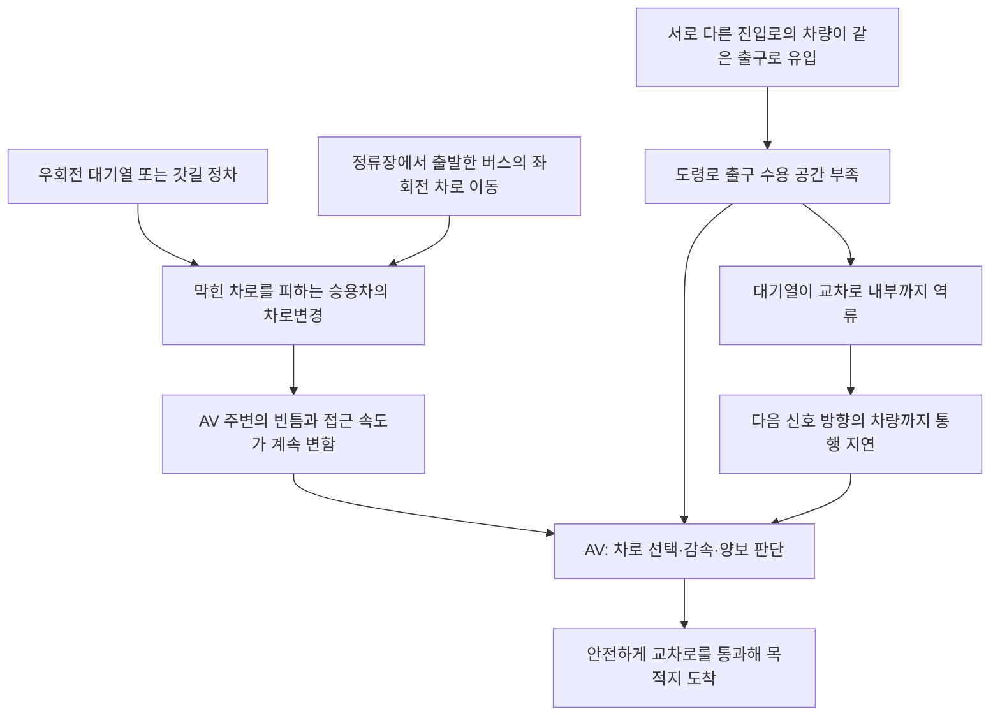

### 노드별 상황 그림

다음 그림들은 위 구조도의 **A~J 노드와 일대일로 대응**한다. A~D는 노형로 진입부를 펼친 차로 확대도이며, E~J는 현재 SUMO 도로 중심선을 활용한 오거리 배치도다. 정류장·병목 위치, 차로 역할, 차량 크기는 설명용 가정이다. 실제 신호표나 학습된 주행 결과를 나타내지 않는다.

그림 색상은 빨강=AV, 파랑=버스, 회색=일반 차량, 황토색=병목·대기열이다. 점선 화살표는 의도하거나 예상하는 이동을 표시하며, 동시에 반드시 실행된다는 의미는 아니다.

#### A. 우회전 대기열 또는 갓길 정차

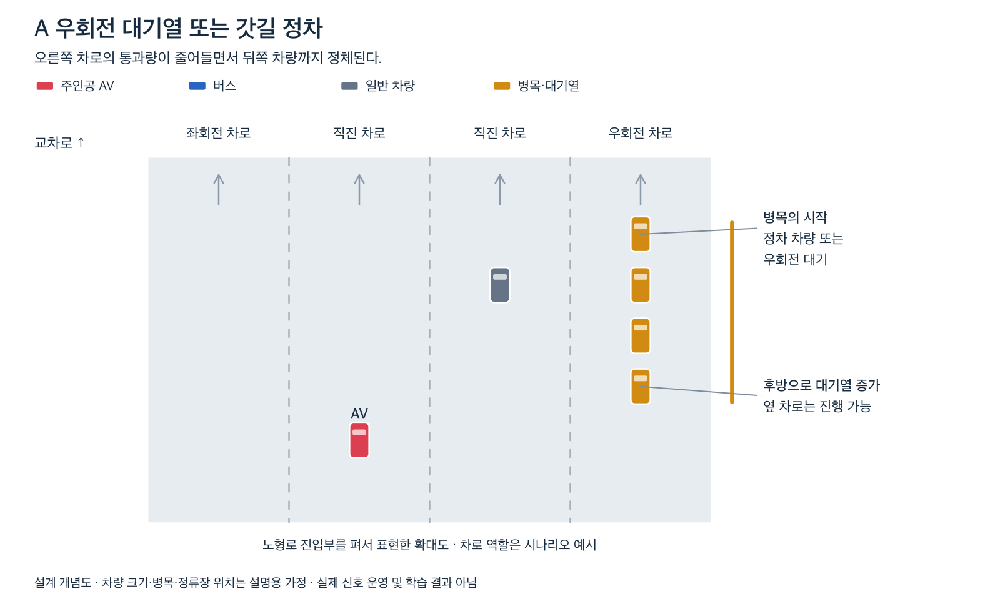

- **그림의 상황:** 오른쪽 차로가 정차 차량 또는 우회전 대기로 막히지만 옆 차로에는 진행 공간이 있다.
- **직접적인 결과:** 해당 차로 뒤쪽 차량의 속도가 낮아지고 대기열이 길어진다.
- **다음 연결:** 이 대기열을 피하려는 승용차의 차로변경(B)이 발생할 수 있다. 갓길 정차와 우회전 대기는 별도 실험 조건으로 구성한다.

#### B. 막힌 차로를 피하는 승용차의 차로변경

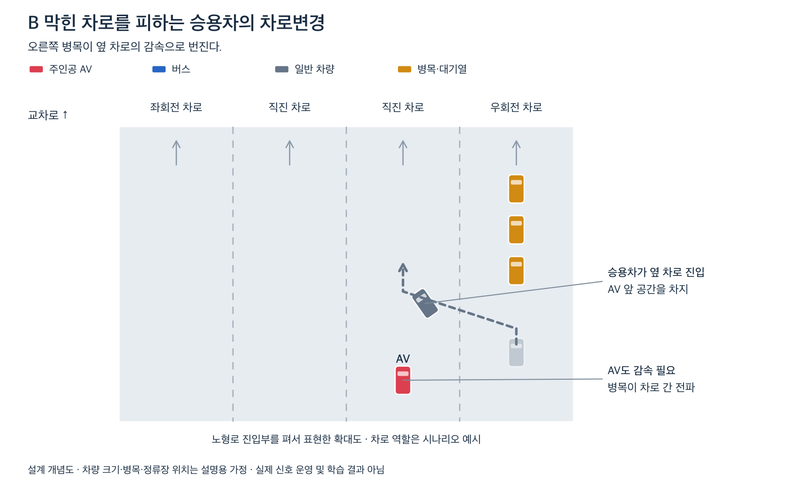

- **그림의 상황:** 대기열 뒤의 승용차가 왼쪽의 진행 가능한 차로로 이동하려 한다.
- **직접적인 결과:** 진입하려는 차로의 차량과 AV도 간격을 조정해야 하므로, 오른쪽에서 시작된 병목이 옆 차로의 감속으로 전파된다.
- **다음 연결:** AV 주변의 빈틈과 상대속도가 변하는 상황(D)으로 이어진다.

#### C. 정류장에서 출발한 버스의 좌회전 차로 이동

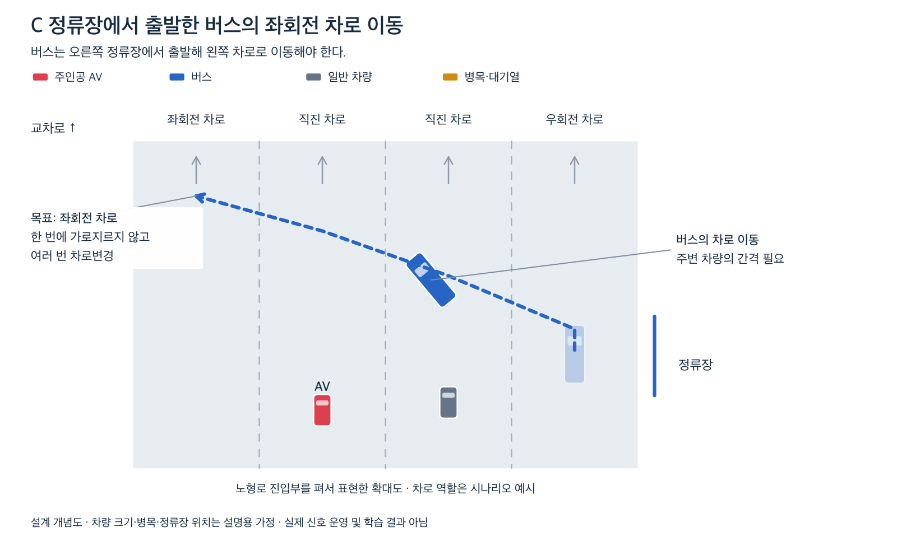

- **그림의 상황:** 버스는 오른쪽 정류장에서 출발하지만 목적지 경로를 따라가기 위해 왼쪽 좌회전 차로로 이동해야 한다. 연한 버스는 정차 위치, 진한 버스는 이동 중인 위치를 뜻한다.
- **직접적인 결과:** 버스가 순차적으로 차로를 변경하는 동안 여러 차로의 차량 간격과 속도에 영향을 준다. 실제로 차로들을 한 번에 가로지르도록 명령한다는 뜻은 아니다.
- **다음 연결:** 버스 뒤를 피하려는 승용차(B)와 버스 자체의 이동이 함께 AV의 판단 조건(D)을 바꾼다.

#### D. AV 주변의 빈틈과 접근 속도가 계속 변함

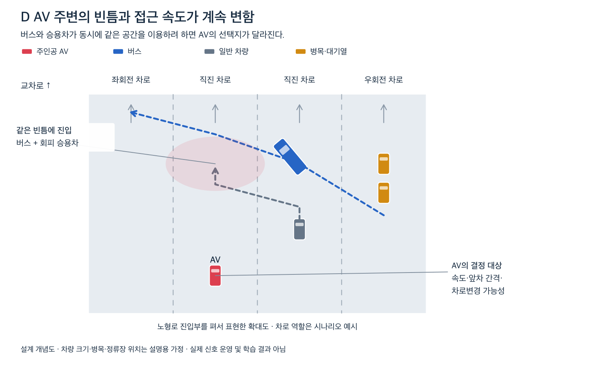

- **그림의 상황:** 버스는 좌회전 차로로 이동하고, 승용차는 막힌 차로를 피하면서 AV 앞쪽의 같은 공간을 이용하려 한다.
- **직접적인 결과:** 조금 전에는 충분했던 빈틈이 줄어들고 앞차·옆 차의 상대속도도 변한다.
- **다음 연결:** AV는 한 차량만 보는 대신 여러 차량의 움직임을 관측해 속도·차로 선택(I)을 조정해야 한다.

#### E. 서로 다른 진입로의 차량이 같은 출구로 유입

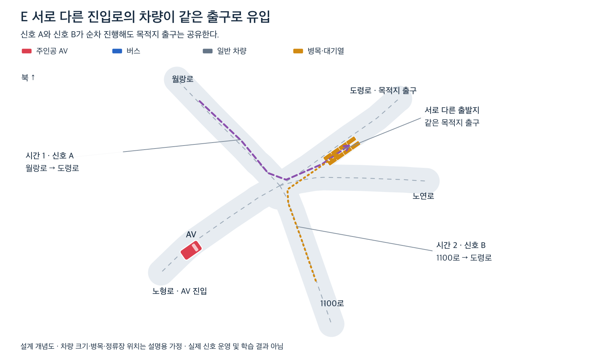

- **그림의 상황:** 월랑로 차량은 신호 A에서, 1100로 차량은 이후 신호 B에서 도령로로 진출한다. 출발 방향은 다르지만 출구는 같다.
- **직접적인 결과:** 신호가 바뀌어도 이전에 유입된 차량의 대기열은 남을 수 있으므로, 다음 차량들이 사용할 출구 공간이 줄어든다.
- **다음 연결:** 유입량이 출구 방출 능력을 넘으면 출구 수용 공간 부족(F)으로 이어진다. A·B는 실제 노형오거리의 신호 순서가 아닌 설명용 시점이다.

#### F. 도령로 출구 수용 공간 부족

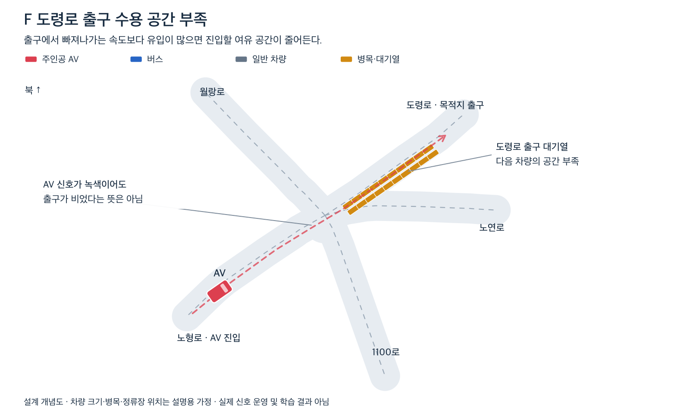

- **그림의 상황:** 도령로 출구에 대기 차량이 쌓여 다음 차량이 들어갈 공간이 부족하다.
- **직접적인 결과:** AV의 진행 신호가 녹색이어도 안전하게 교차로 밖으로 빠져나갈 수 있다고 보장되지 않는다.
- **다음 연결:** 일부 차량이 충분한 공간 없이 들어오면 대기열이 교차로 내부로 역류(G)할 수 있다. AV는 출구 공간도 진입 판단(I)에 반영해야 한다.

#### G. 대기열이 교차로 내부까지 역류

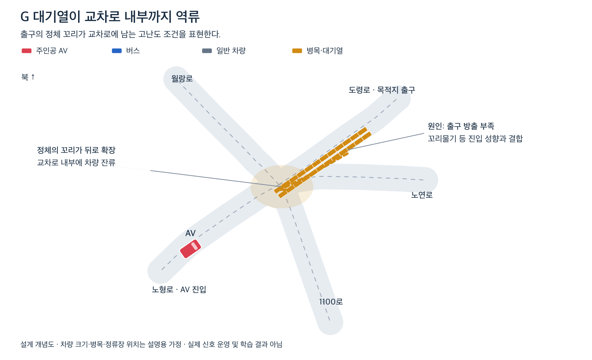

- **그림의 상황:** 출구 정체가 해소되지 않은 상태에서 진입한 차량이 교차로 안에 남고, 정체의 꼬리가 교차로 쪽으로 확장된다.
- **직접적인 결과:** 출구 하나의 문제가 교차로 내부 공간을 점유하는 문제로 바뀐다.
- **다음 연결:** 잔류 차량의 위치가 다른 방향의 경로와 겹치면 다음 신호 차량까지 통행 지연(H)을 받는다. 이 현상은 출구 방출 부족과 꼬리물기 성향이 결합된 고난도 조건으로 별도 검증한다.

#### H. 다음 신호 방향의 차량까지 통행 지연

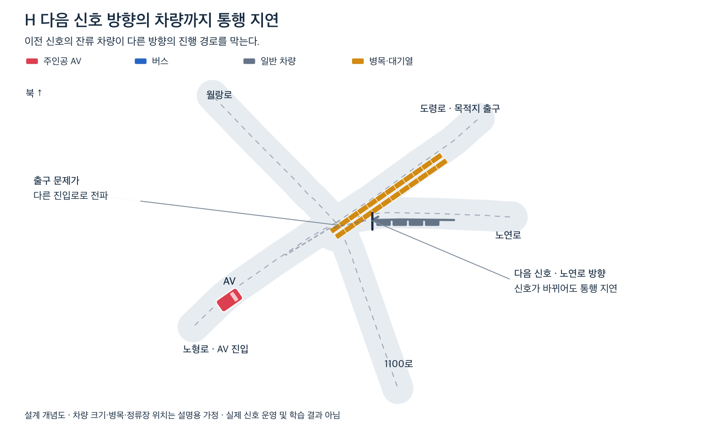

- **그림의 상황:** 이전 흐름에서 도령로로 향하던 차량들이 교차로 내부에 남아, 다음 신호의 노연로 → 노형로 경로를 가로막는다.
- **직접적인 결과:** 출발지도 목적지도 다른 차량들까지 대기하게 되고 여러 접근로의 대기열이 함께 증가한다.
- **다음 연결:** AV는 자기 신호뿐 아니라 잔류 차량과 교차로 공간을 고려한 진입 판단(I)이 필요하다. 충돌하는 방향에 동시에 녹색을 준 장면이 아니다.

#### I. AV의 차로 선택·감속·양보·진입 판단

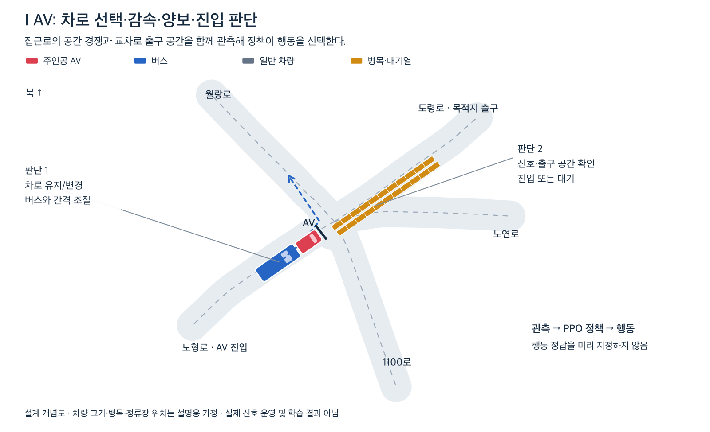

- **그림의 상황:** AV는 접근로의 공간 경쟁(D), 목적지 출구 부족(F), 다른 방향까지 번진 정체(H)를 함께 마주할 수 있다.
- **판단 1 — 접근로:** 기다릴지, 차로를 바꿀지, 감속해 버스에 공간을 제공할지 선택한다.
- **판단 2 — 교차로 진입:** 신호와 출구 공간을 보고 지금 들어갈지 정지선 앞에서 기다릴지 선택한다.
- **다음 연결:** 관측 → PPO 정책 → 행동으로 연결한다. 정답 행동을 미리 코딩하지 않고, 보상과 결과를 통해 목적지 도착(J)에 유리한 전략을 학습한다.

#### J. 안전하게 교차로를 통과해 목적지 도착

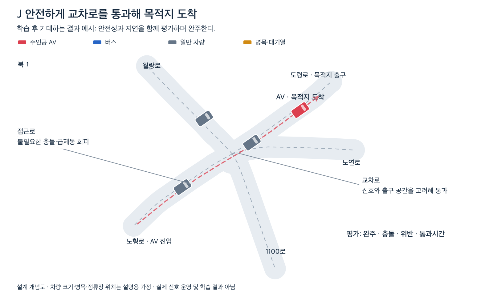

- **그림의 상황:** 필요한 감속·양보·차로 선택과 진입 판단을 거쳐 도령로의 목적지까지 주행한다.
- **평가할 결과:** 완주 여부, 충돌, 신호위반, 급제동, 통과시간 및 안전 제약 개입률을 함께 확인한다.
- **해석:** 기대하는 성공 사례의 개념도이며, 현재 학습 모델이 이 성능을 달성했다는 의미는 아니다.

### 상황 간 연결

1. 우회전 대기열이 길어져 직진 차량들이 다른 차로로 이동한다.
2. 정류장에서 출발한 버스가 좌회전 차로를 향해 이동한다.
3. 버스를 피하는 승용차도 차로변경을 시도해 AV 주변 간격이 변한다.
4. 월랑로·1100로 등 다른 접근로의 차량들이 앞선 신호에서 도령로 출구로 유입된다.
5. AV의 녹색 신호가 켜졌어도 출구가 가득할 수 있다.
6. 출구 대기열이 교차로 안까지 번지면 다음 신호의 다른 방향 차량도 영향을 받는다.

서로 충돌하는 진입 방향을 동시에 녹색으로 설정한다는 의미는 아니다. **신호 시점이 달라도 이전 흐름의 대기열이 다음 흐름에 영향을 주는 상황**을 표현한다.

정체는 강제 충돌·차량 위치 고정으로 만들지 않는다. 수요·정류장 위치·정차시간·출구 수용량을 조절해 발생·해소되도록 설계한다. 꼬리물기 성향 차량을 추가한다면 발생 비율과 규칙을 명시하고 별도 조건으로 평가한다.

도로 중심선 출처: © [OpenStreetMap 기여자](https://www.openstreetmap.org/copyright). 차로 폭·정류장·차량 배치는 설명용으로 구성했다.
